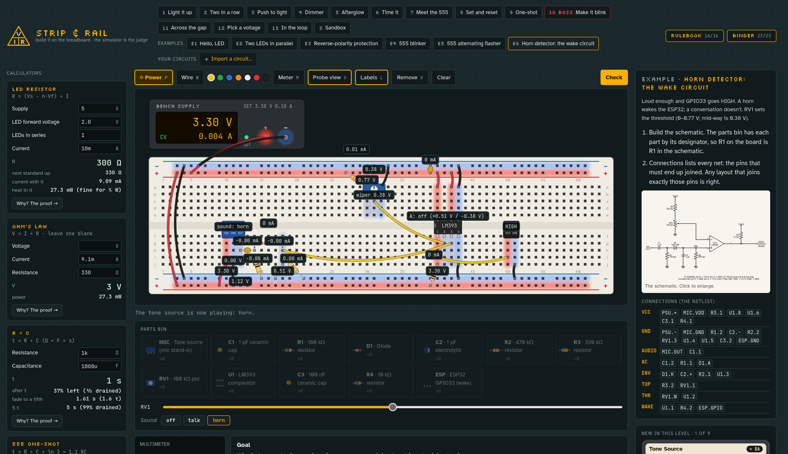
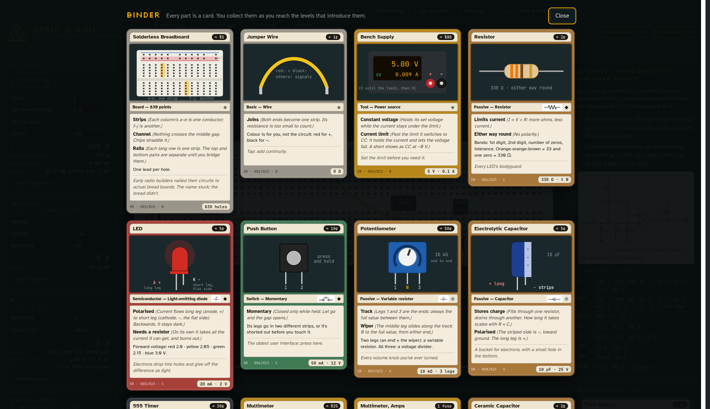
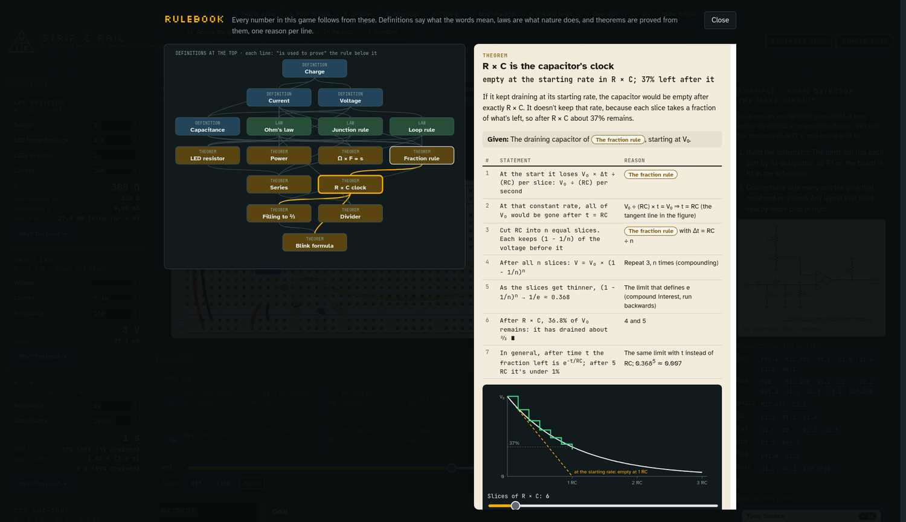
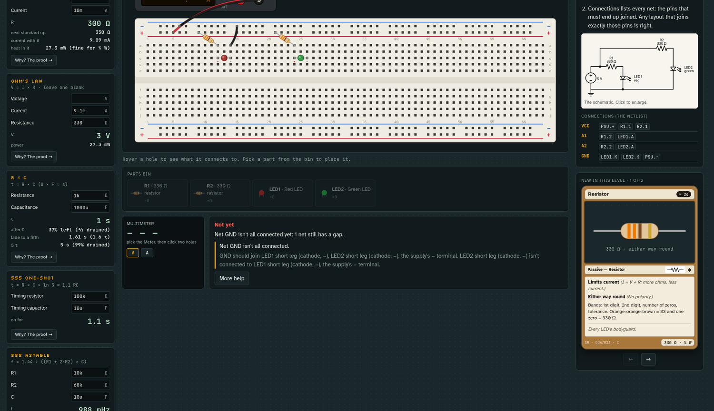

# Strip & Rail

**A breadboard puzzle game with a real circuit simulator.** Each level hands you a schematic and a parts bin.
You build it on an 830-point breadboard, power it from a bench supply, and the simulator judges it by what the
circuit **does**: the LED lights at 4–25 mA, it blinks at 0.5–2 Hz, a horn wakes the microcontroller and a
conversation doesn't. Any layout that works passes. When it's wrong, the hints read your build and name the
problem: a resistor with both legs in one strip, a backwards LED, an unbridged rail, a net that isn't connected.

**▶ Play it: [paddylopez.github.io/strip-and-rail](https://paddylopez.github.io/strip-and-rail/)**, or download
[`dist/strip-and-rail.html`](dist/strip-and-rail.html) and open it. It's one self-contained file that works offline.



## What's in it

- **13 levels, one idea each.** LED and resistor → series → a button → a pot → a capacitor → R × C timing →
  the 555 → pull-ups and a latch → a one-shot → **the boss: the 555 astable blinker** → the multimeter →
  a voltage divider → measuring current in series (where the meter's fuse can really blow).
- **A real simulator.** Nodal analysis with Newton iterations for diodes and LEDs, time steps for capacitors,
  a behavioural 555, open-collector comparators, and a bench supply that current-limits like a real one.
  LEDs burn out without a resistor. Powered strips glow by voltage; hover anything for its readings.
- **Every part is a card.** The art is the part as it sits on the bench, the keywords are its rules, the stats
  box its ratings. Collect all 23 in the Binder.
- **The Rulebook: the proofs behind the formulas.** Why is 1 kΩ × 1000 µF = 1 second? Why is the 555's
  on-time 1.1 × R × C? Two-column proofs from definitions and laws, each reason a link to the rule it uses.
- **Calculators** that unlock as the levels need them: LED resistor, Ohm's law, R × C, 555 one-shot and astable, divider.
- **Your own circuits as levels.** Write a parts list and a netlist in YAML, or **export a netlist from KiCad**,
  and drop the file on the game. It becomes a level: the bin holds your parts by designator, and Check compares
  your breadboard with the schematic's nets.

| | |
|---|---|
|  |  |
|  | |

## Your circuits

A circuit file is a parts list plus a netlist, the pins each wire joins:

```yaml
format: strip-and-rail/circuit@1
title: Hello, LED
supply: { v: 5, ilim: 100m }
parts:
  R1:   { part: resistor, value: 330 }
  LED1: { part: led, color: red }
nets:
  VCC: [PSU.+, R1.1]
  A:   [R1.2, LED1.A]
  GND: [LED1.K, PSU.-]
win:
  - wiring: nets
  - goal: { kind: lit, count: 1, min: 4m, max: 25m }
```

- [docs/CIRCUITS.md](docs/CIRCUITS.md): the format.
- [examples/](examples/README.md): six worked translations from schematic to file, including a real project (a
  train-horn detector's wake circuit: an envelope detector, an LM393 and an ESP32 wake pin).
- [docs/KICAD.md](docs/KICAD.md): KiCad netlists (KiCad 5 or 6+), in the game or with
  `node tools/kicad2circuit.js project.net`. Anything the game can't map yet is left out and said so, never guessed.

## Building it

```
node --test test/        # 75 tests: the physics, the proofs' structure, the data, circuits, KiCad import
./build.py               # tests, then draws the schematics and writes dist/strip-and-rail.html
```

The tests need Node 20+. The build also needs Python 3 and [Schemdraw](https://schemdraw.readthedocs.io/)
(`pip install schemdraw`) for the schematics.

| Where | What |
|---|---|
| `data/` | **everything a player sees**: parts, cards, levels, the Rulebook, KiCad symbol map. As JSON. [docs/DATA.md](docs/DATA.md) |
| `src/engine.js` | the board's rules, the solver, goals and hints |
| `src/ui.js`, `src/cards.js`, `src/style.css`, `src/page.html` | the game, card art, rendering |
| `src/circuit.js`, `src/kicad.js` | circuit files and KiCad netlists → levels |
| `src/calc.js`, `src/data.js` | calculators; loading the data |
| `schematics/`, `examples/` | level schematics; example circuits and their drawings |
| `tools/`, `test/`, `vendor/` | the data bundler and KiCad CLI; the tests; js-yaml |

## Honest limits

The models are simplified. LEDs have a fixed forward voltage per colour, the 555 is a textbook behavioural
model, and the tone source stands in for a microphone. The numbers land within a few percent of the real
thing, which is right for learning; your bench will differ a little, and that's what a trimmer is for.

## Contributing

New parts, cards, levels, examples and KiCad symbol mappings are mostly data. See [CONTRIBUTING.md](CONTRIBUTING.md).

## License

MIT: see [LICENSE](LICENSE). Bundled: [js-yaml](https://github.com/nodeca/js-yaml) (MIT). Fonts load from
Google Fonts (SIL Open Font License), with system fallbacks.
